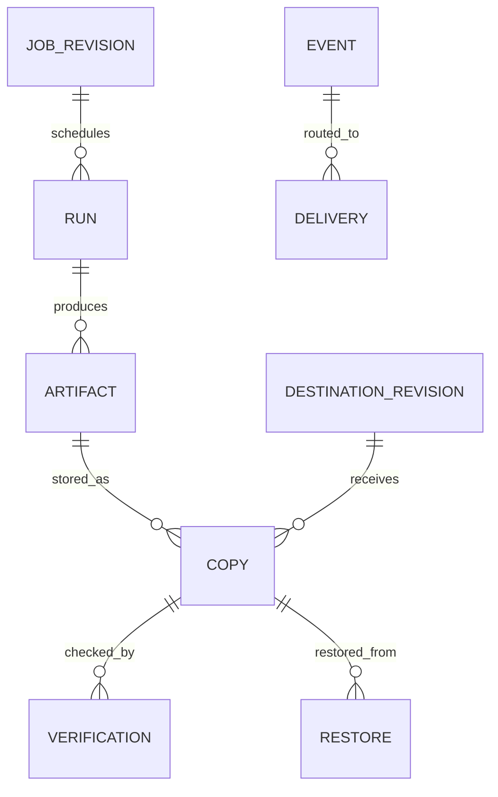

# Database design

**Document status:** Architecture v0.1 approved under H1 on 2026-10-24; no implementation.

## Approval record

The human approved architecture v0.1 and P01-P09 on 2026-10-24; see [H1 evidence in ADR-001](../04-decisions/ADR-001-single-server-backup-architecture.md). Proposal/default wording below records the approved design rationale, not a pending repeat approval. Unknown deployment facts remain unresolved; H2/H3/H4 are not granted.

## Purpose

Define local metadata ownership, transactional job state, artifact/copy history and recovery. This database stores BkpLight metadata, not the source databases' application records.

## Ownership and entities

The daemon is the sole writer to SQLite on a local persistent volume. YAML is the authority for current configuration; SQLite holds redacted immutable configuration revisions and runtime history. Removing a YAML source/job disables future runs but does not delete its historical records or remote copies. IDs are stable operator-assigned strings for configuration and generated opaque IDs for runs/artifacts/events.

| Entity | Main fields | Constraints / purpose |
|---|---|---|
| config_revisions | revision_id, schema_version, normalized_hash, redacted_snapshot, activated_at | Immutable normalized config; secret references only, no secret contents |
| source_revisions | source_id, config_revision_id, engine, connection_label, scope | Composite identity retains engine/topology/scope seen by each run |
| destination_revisions | destination_id, config_revision_id, provider, container_ref, prefix, credential_ref | Preserve the original bucket/folder binding for history and deletion |
| job_revisions | job_id, config_revision_id, source_id, selected_databases, schedule, timezone, policy_snapshot | A running job uses a fixed revision, including destination requirements and retention policy |
| schedule_slots | slot_id, job_id, schedule_revision, job_revision, local_slot_key, scheduled_at_utc, state, reason | Unique job/schedule revision/local slot; schedule revision changes only with timing/timezone changes, not unrelated YAML edits |
| runs | run_id, job_revision, slot_id nullable, trigger, request_id, source_id, started_at, finished_at, state, error_code | Unique manual request_id; aggregate run outcome distinct from artifact/copy outcomes |
| artifacts | artifact_id, run_id, database_scope, engine/tool_versions, consistency, captured_from/to, local_state, relative_path, ciphertext_size, ciphertext_sha256, manifest_ref, key_id, pinned | One artifact per selected database; optional PG globals are a separate scoped artifact; capture interval is not a MongoDB snapshot claim |
| copies | copy_id, artifact_id, destination_revision, required, provider_object_ids, upload_session_ref, state, integrity_method, verified_hash, committed_at, deletion_state | Unique artifact + destination revision; provider IDs immutable after commit |
| operation_attempts | attempt_id, operation_type, entity_id, attempt_no, started/ended, status, provider_receipt_ref, redacted_error, next_attempt_at | Durable retry/reconciliation audit; sensitive session URLs stored through secret-state references |
| verifications | verification_id, copy_id, target_id, profile, target_identity, state, assertions, started/ended, error | Passed applies only to this copy/profile/engine combination; never rewrites artifact consistency |
| restore_plans / restores | plan_id, plan_digest, expires_at, copy_id, target_identity, new_database, profile, confirmation, operation_state | Bound preview/confirmation and idempotent restore operation; no implicit existing-target overwrite |
| artifact_claims | claim_id, artifact_id/copy_id, operation_id, purpose, expires_at | Prevent retention/local cleanup while upload, verification or restore uses a copy |
| events | event_id, aggregate_id, sequence, event_type, payload_version, redacted_payload, occurred_at | Created in the same transaction as corresponding state transition |
| deliveries | delivery_id, event_id, channel_revision, state, attempts, next_attempt_at, last_status, receipt_ref | Unique event + channel revision; disabled/unsubscribed channels produce no delivery |
| audit_entries | audit_id, actor_label, operation, target_ids, outcome, evidence_ref, timestamp | Restore confirmations, pins, config changes, retention and reconciliation actions |
| schema_migrations | version, applied_at, checksum | Ordered migrations and compatibility detection |

Indexes target job history by time, latest committed copy by scope/destination, runnable retries, pending event deliveries and active claims. Fields are a conceptual contract; exact SQL/types/index definitions are implementation-plan work.

## Integrity and concurrency

Enable foreign keys, WAL and an appropriate busy timeout; use short serialized write transactions and bounded retries for busy errors. Hold an OS-level singleton lock on the state directory for daemon lifetime. CLI processes communicate with that daemon and do not write SQLite directly. Work occurs outside transactions; its result and corresponding outbox event commit together. Use compare-and-set state/version checks and per-source locks to prevent stale workers completing cancelled operations.

No database transaction can atomically cover SQLite, remote storage and the filesystem. Persist intent before external mutation; store stable operation IDs/provider receipts and reconcile before retry. A notification worker reads pending deliveries only after the state/event transaction commits. With zero channels, events/history still exist but no outbound delivery is scheduled.

### State contracts

| Record | Normal states | Recovery / failure states |
|---|---|---|
| Run | queued -> preflight -> dumping -> delivering -> succeeded/degraded | failed, cancelled, interrupted; required copies determine failed vs success, optional failures cause degraded |
| Local artifact | writing -> staged -> removed | failed, interrupted; `.partial` is never staged |
| Remote copy | pending -> uploading -> integrity_check -> committed | retry_wait, unknown, failed; unknown requires reconciliation |
| Verification | queued -> downloading -> restoring -> checking -> passed | failed, interrupted; consistency remains a separate artifact field |
| Restore | planned -> confirmed -> restoring -> checking -> completed | expired plan, failed, interrupted; do not auto-resume destructive work |
| Delivery | pending -> sending -> delivered | retry_wait, unknown, failed, expired, cancelled |
| Retention | planned -> deleting -> deleted | failed/unknown pending reconciliation; history retains tombstone |

Source snapshot consistency labels include `postgres_per_database` and `mongo_live_not_guaranteed`; neither asserts cross-database consistency. A successful archive checksum, delivery or restore is a different dimension.

### Disk and process ownership

Track actual bytes for all staging writers and downloads, including partial files. Reserve configured budget before starting; extend reservations atomically as output grows and refuse writes that exceed the cap or free-space reserve. Proposed heavy-work concurrency of one simplifies bounding; increasing concurrency must preserve global accounting. Verification target database volumes and local logs have separate budgets and checks. Kill/reap the native producer on write failure; retain its bounded error evidence.

On startup, reacquire singleton ownership, reconcile staging files against records and mark lost in-flight dumps interrupted. Reconcile remote uploads using persisted keys/IDs before creating another copy. Expired claims are released only after checking that their operation is not active. A local staged file surviving a crash is reusable only after size/hash verification and a completed manifest; otherwise quarantine or delete it as incomplete within the managed directory.

## Lifecycle and migrations

Retention groups are `(job_id, source_id, database_scope, destination_id)` with destination revision binding retained for each object. Evaluate only committed integrity-checked copies. Keep the union of the latest N and the age window if both are configured. Also keep pinned copies, active-operation claims, the latest passed verification copy where configured and a minimum of one committed copy per group. Protected copies can exceed requested count/age and must be explained in retention preview.

Order by artifact capture completion time with artifact ID as a stable tie-breaker; age uses UTC capture completion, not delayed upload time. `keep_days: 7` retains captures within the rolling previous 7 x 24 hours. Require at least one positive count/age rule and reject invalid/negative values. Copies now known corrupt are quarantined and excluded from the healthy minimum/latest-verified calculation; preserve evidence and prior verification records without presenting an old pass as current health. A later application-assertion failure records profile-specific failure rather than automatically declaring bytes corrupt.

Changing a destination's physical bucket/folder/prefix starts a new retention group binding even if its logical ID is reused. Old locations remain protected under their last reviewed policy and are not silently made deletable because a new location has a copy. If no new committed copy exists, no automatic retention deletion runs for that group. Counts can exceed the configured target due to protection, backlog or failure; preview explains why.

Before each delete, transactionally claim the candidate and recheck protections so a concurrent restore/pin cannot race cleanup. Reject new restore claims for deleting copies. Delete only explicit cataloged provider IDs under the original owned prefix/folder; provider NotFound after a known delete is reconcilable, not permission to delete another object. Record manifest/marker cleanup as part of the deletion operation. Never treat unknown/partial objects as successful copies or apply wildcard deletion to a user bucket/folder.

Local staging cleanup is independent of remote retention. Keep undelivered archives until successful delivery or explicit operator discard; expose exhausted retries/disk backlog and block new dumps at the configured cap. Finite storage cannot guarantee indefinite backlog retention and continued backups simultaneously. Operator cancellation/discard must disclose which destinations lack copies.

History proposal: keep live artifact/copy references indefinitely; compact expired-copy history and detailed attempt/error payloads under a configurable history-retention policy, preserving summary/tombstone and audit references needed for recovery. TODO: final time defaults and size budgets. Never purge records still referenced by active copies or operations.

Migrations run before scheduling after a consistent SQLite backup. Refuse an unknown newer schema. Test migrations and recovery in staging. Roll back by restoring a compatible application/state backup, not by assuming arbitrary down-migrations are safe. Reconcile remote artifacts created after that snapshot before enabling retention; restored stale state must not trigger deletion automatically.

## Recovery

Back up SQLite using its supported online backup mechanism or a clean stopped snapshot; never copy only an active WAL database file. Keep protected configuration, state backup and independent encryption/signature recovery material off the production host. [SQLite backup documentation](https://www.sqlite.org/backup.html), [WAL constraints](https://www.sqlite.org/wal.html).

Each remote artifact has a versioned encrypted manifest and signed commit metadata, allowing catalog reconstruction after host/state loss. Manifests carry engine/tool versions, scope, consistency label, timestamps, artifact hash/size and logical IDs; they contain no credentials. Physical provider IDs are recorded per copy and commit receipt. Import requires known trusted signing public keys and configured destination ownership. Preview imported entries, mark them recovered, disable destructive retention until reconciliation is reviewed and never reconstruct secrets from manifests.

State is disposable for locating committed archives, but losing it loses unexported detailed delivery/audit history. Restore evidence must be retained in state backups or exported reports; importing an archive does not invent a past verification result. TODO: finalize state-backup schedule and recovery drill commands for the actual deployment.

## Related documentation

- [System overview](system-overview.md)
- [API and configuration design](api-design.md)
- [Security design](security-design.md)
- [Infrastructure design](infrastructure-design.md)
- [Backup and recovery](../07-deployment/backup-recovery.md)
