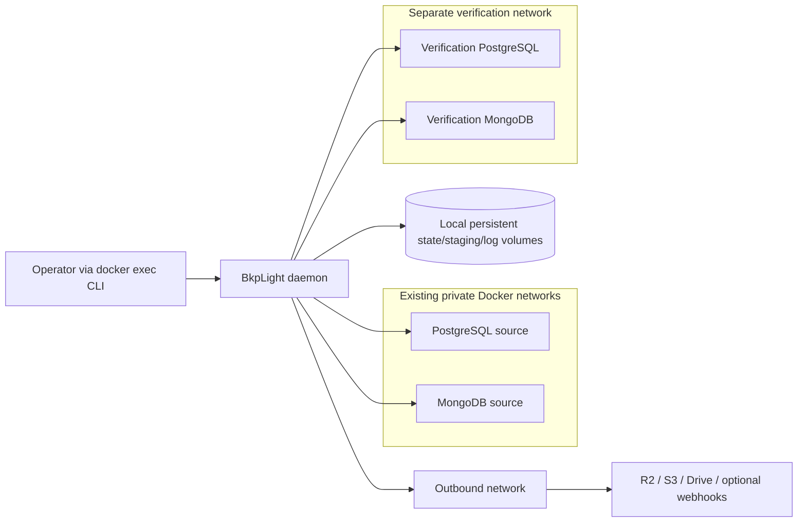

# Infrastructure design

**Document status:** Architecture v0.1 approved under H1 on 2026-10-24; no implementation.

## Approval record

The human approved architecture v0.1 and P01-P09 on 2026-10-24; see [H1 evidence in ADR-001](../04-decisions/ADR-001-single-server-backup-architecture.md). Proposal/default wording below records the approved design rationale, not a pending repeat approval. Unknown deployment facts remain unresolved; H2/H3/H4 are not granted.

## Purpose

Define the proposed Docker runtime, resource limits and recovery prerequisites for one operator-owned server.

## Runtime topology

Recommend Linux Docker Engine with Compose, one BkpLight daemon and separately provisioned PostgreSQL/MongoDB verification services. Source databases stay in their existing containers. The daemon connects through Docker DNS/service aliases and container ports; no source port needs publication on the host.

Attach BkpLight to each explicitly selected existing network. Compose `external: true` means the network is managed outside this Compose project; it does not mean internet-exposed. Use unique aliases when networks contain duplicate service names. A separate egress-capable bridge provides outbound provider access when source networks are internal. Do not assume every attached network has internet access.

Verification databases use a dedicated network, separate credentials/volumes and no published ports. They do not join source networks. Restrict their egress where practicable. The daemon bridges trust domains by design and must be protected accordingly. Provision verification containers through Compose under operator control; BkpLight gets no Docker socket and does not discover or start arbitrary containers.

## Resources and access

### Mounts and execution identity

| Path class | Proposed access and storage | Recovery responsibility |
|---|---|---|
| YAML config | Read-only mount | Save an off-host copy without secrets |
| Bootstrap secrets / key files | Read-only, UID-restricted file mounts | Independent secure credential/key custody |
| SQLite state | Persistent local filesystem, writable only by daemon | Consistent SQLite backup; restore/reconcile before scheduling |
| Mutable credentials | Separate restricted persistent store | Refresh tokens/session handles; exclude from ordinary logs/history export |
| Encrypted staging | Persistent local filesystem with enforced application budget | Retry archive uploads after restart; not an off-host backup |
| Logs | Persistent local files, restricted and rotated | Separate disk budget and operational retention |
| Runtime socket / native secret files | tmpfs for `/run/bkplight`, size-limited | Ephemeral; recreated on restart |
| Verification database data | Separate restricted volumes | Resource-limited disposable verification data; not production storage |

Use a non-root UID, read-only container root filesystem, dropped capabilities and `no-new-privileges`. Run native database clients as that UID. No privileged mode, host networking or broad host mounts. Use local disk for SQLite WAL; NFS/shared-network filesystems are unsupported for state. Only one daemon may own a state directory.

### Resource budgeting

Count all partial archives, staged artifacts and downloaded verification/restore archives against the configured staging cap. Reserve capacity before starting and enforce actual bytes while streaming. Keep a configurable minimum free-space reserve. If capacity runs out, terminate/reap the producing process, record failure, remove only incomplete owned files and stop new dumps. Never discard an undelivered finalized backup just to admit another job.

Verification database expansion, SQLite/WAL, logs and tmpfs have separate budgets; an archive cap is not a host disk quota. Docker named volumes do not automatically impose size limits. Use supported filesystem quotas or dedicated partitions and monitor host free space. Concurrent reservations must account for all writers on the filesystem.

Propose one heavy dump/restore/verification operation globally and two uploads by default. Set CPU, memory, PID and operation timeout limits in Compose; benchmark with realistic data before increasing concurrency. Same-host verification competes with production workloads: schedule it off-peak, cap resources and allow an explicitly configured external isolated verification target later if needed. CPU/memory limits do not guarantee zero source impact.

Proposed logs: structured JSON lines, 20 MiB per file, at most 10 files and 14 days (delete on either limit), configurable. Audit summaries live in SQLite with a separately configured retention policy. Per-run native diagnostics count toward the same log budget. Configure Docker stdout/stderr rotation too; application rotation does not limit Docker's log driver. Redact and bound messages before enqueue/write.

Graceful termination stops new scheduling and gives active processes a bounded completion/cancellation period. Reap child processes and flush durable state. On restart reconcile incomplete intents and files before resuming due jobs; do not resume partial database dumps. Configure container restart policy and health checks without creating a restart loop for a provider outage.

## Delivery and recovery

### Health and monitoring

Expose a local health CLI for daemon liveness, config validity, writable state, disk pressure and scheduler operation. Separately report last committed required-copy age per database, failed/pending uploads, verification age/outcome, missed slots and notification delivery issues. A running process is not proof that backups are current. Optional webhooks may be absent and do not affect core operation.

Use separate liveness and operational-degradation outputs: a failed remote destination should alert the operator, not cause repeated container restarts. A dead host cannot emit its own failure webhook; recommend an external heartbeat/last-backup observer before production. TODO: operator alert thresholds, observer and escalation ownership; V1 does not promise an RPO.

### Build, release and rollback

Build an immutable image containing the daemon and compatible pinned native tools; a scratch image alone cannot run those tools. Record tool/runtime versions and image digest. Include CA roots and timezone data. Choose maintained patched dependencies and verify the supported engine/tool/host architecture matrix; no versions or CPU architectures are claimed yet.

Before production: run the exact candidate in isolated staging with separate source fixtures, provider prefixes/folders and notification channels; demonstrate backup, remote retrieval, isolated restore, retention boundaries, disk exhaustion and crash reconciliation. Capture a consistent state backup and recovery material, rehearse rollback, and configure monitoring. Human H4 approval must name the artifact, target and reviewed procedure. This architecture is not deployment permission.

State migrations must have a pre-migration backup. Refuse an older binary against a newer incompatible state schema. Rollback uses a compatible image/state pair and reconciles provider side effects with retention disabled; restoring stale SQLite must never trigger blind remote deletion. Do not roll back user database contents automatically as part of application rollback.

### Whole-host disaster recovery

Maintain an independent recovery kit: YAML/config revision, destination account/endpoint/folder identifiers, decryption keys, trusted signing public keys, credentials or a documented way to reissue them, image/tool version references and runbook. No key should exist only on the failed host or solely inside encrypted backups it unlocks.

Rebuild on a clean server, load trusted recovery material, enumerate and validate signed remote commit records, import a catalog with retention disabled, download and test selected backups, then restore to new databases. Restore verification does not prove standalone MongoDB snapshot consistency. Review imported ownership/schedules before enabling deletion or scheduling. Local state improves history but cannot be the only way to locate remote backups.

TODO: inventory actual networks, aliases, host OS/CPU, database versions/sizes, disk capacity, provider accounts, maintenance windows and performance acceptance limits before dependent implementation/release tasks.

## References

- [Docker Compose networking](https://docs.docker.com/compose/how-tos/networking/)
- [SQLite WAL filesystem constraints](https://www.sqlite.org/wal.html)
- [Docker JSON log rotation](https://docs.docker.com/engine/logging/drivers/json-file/)

## Related documentation

- [System overview](system-overview.md)
- [Infrastructure inventory](../07-deployment/infrastructure.md)
- [Deployment guide](../07-deployment/deployment-guide.md)
- [Security and permissions](security-design.md)
- [Production release process](../07-deployment/production-release-process.md)
