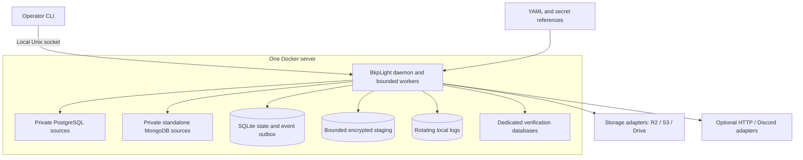

# System overview

**Document status:** Architecture v0.1 approved under H1 on 2026-10-24; no implementation.

## Approval record

The human approved architecture v0.1 and P01-P09 on 2026-10-24; see [H1 evidence in ADR-001](../04-decisions/ADR-001-single-server-backup-architecture.md). Proposal/default wording below records the approved design rationale, not a pending repeat approval. Unknown deployment facts remain unresolved; H2/H3/H4 are not granted.

## Purpose

Define a reviewable version-one design for the PRD and our discussion, including alternatives, reliability boundaries and explicit decisions requiring approval.

## Authority

On 2026-10-24 the user requested architecture design based on the approved PRD, comparison of alternatives and a subsequent approval request. This authorizes drafting and review, not implementation. The PRD file still contains unresolved sections: confirmed requirements REQ-001 through REQ-015 and clarification decisions C01-C05 are the baseline; choices below are proposed resolutions, not retroactively confirmed user answers. The subsequent H1 approval accepts this design version and P01-P09; H2/H3/H4 remain ungranted.

## Context and boundaries

One trusted operator manages one Docker server, multiple PostgreSQL/MongoDB databases, private Docker networks, scheduled backups, YAML configuration, remote destinations, retention, restore verification, optional webhooks and local logs. Applications remain online. Existing MongoDB is standalone; its live dumps have no cross-collection point-in-time consistency guarantee. Temporary local archives with a configurable disk limit are accepted. No guaranteed RPO, automatic topology conversion or zero-impact performance promise is made.

## Alternatives and recommendation

| Approach | Strength | Cost / limitation | Proposed disposition |
|---|---|---|---|
| Cron/scripts plus native tools and rclone | Fast initial deployment; broad provider coverage | Durable history, reconciliation, retention protection and notification semantics become bespoke scripts; process configuration spans multiple tools | Suitable for a small manual backup script, not preferred for the requested managed service |
| One application with internal adapters, SQLite and native database tools | One owner for job state; persistent recovery; adapters isolate provider details; simple single-server operation | Single daemon/host failure domain; needs disciplined state transitions and bounded disk use | Recommended |
| API service, queue, workers and external state database | Independent scaling and multi-server execution | More services, credentials, failure modes and operating effort for one host | Defer until a demonstrated multi-server/scaling need |

Within the recommended approach, compare Go with Python/TypeScript and direct provider SDKs with rclone in the technology-stack document. These are proposals for H1 approval, not existing dependencies.

## Components and flows

The daemon is the sole state owner. CLI requests use local IPC; no public HTTP service, broker, Redis or separate application database is proposed for V1. Verification databases are separate Compose services with their own credentials and volumes; the daemon does not start containers through a Docker socket.

| Module | Responsibility and boundary |
|---|---|
| Config | Strict versioned YAML, reference validation, redacted revision snapshot; secrets remain file references |
| Scheduler | Daily/weekly/five-field cron, explicit timezone, durable due slots and overlap policy |
| Orchestrator | Source locks, bounded concurrency, cancellation, state transitions and recovery |
| Database adapters | Preflight/version checks, native backup and restore processes, safe argument construction |
| Archive manager | Stream compression output through encryption into bounded staging; finalize only on successful producer exit |
| Storage adapters | Upload/reconcile/download/inspect/delete, provider receipts and integrity evidence |
| Retention | Plan and apply deletion only to owned committed copies while respecting protection rules |
| Verification / restore | Download a selected remote copy, validate/decrypt and restore to an explicit safe target |
| Event outbox / notifications | Persist events with state changes; asynchronous optional delivery independent of backup outcome |
| Observability | Structured local logs, health CLI, last successful copy age and audit records |

## Approved decisions P01-P09

| ID | Proposed default | Outstanding PRD topics |
|---|---|---|
| P01 | Go modular application, native database tools, SQLite on local storage, one daemon | Stack choice |
| P02 | Linux Docker Compose deployment; YAML + CLI/local IPC; no web UI/public API in V1 | Q08/Q13 |
| P03 | Include R2, Amazon S3 and Google Drive adapters; allow multiple destinations with required/optional flags | Q06; 'S2' is provisionally interpreted as S3 |
| P04 | Explicit selected database lists; MongoDB standalone dumps per database; PostgreSQL custom archives; role/global export opt-in | Q09 |
| P05 | Encrypted local staging; explicit disk cap, no eviction of undelivered backups merely to free space | Q08/Q14/Q15 |
| P06 | Per-job/source/database/destination retention: last N OR age window; pinned copies and latest verified copy protected; minimum one good copy | Q10 |
| P07 | Manual and weekly scheduled remote restore verification on dedicated targets; V1 operator restore creates a new database on a separate allowlisted target instance, in-place overwrite/source-instance restore deferred | Q11/Q12 |
| P08 | Persistent retries and restart reconciliation; no overlap per source; last-success and overdue visibility | Q07/Q15/Q17 |
| P09 | Optional custom HTTP/Discord notifications, bounded queue, secret redaction, rotating logs | Q16 |

H1 approval covers P01-P09 with no stated exceptions. Unknown deployment inventory, account capabilities and performance limits remain TODO and must be resolved before implementation tasks that depend on them. No supported-version or capacity claims are fabricated.

## Backup and scheduling flow

1. Validate configuration at startup. Persist a redacted config revision; invalid config prevents scheduling. V1 applies changes on controlled restart, not live reload.
2. Persist one due slot per job schedule revision. Acquire the source lock and a heavy-work slot before touching the database. Proposed defaults: one dump/verification/restore at a time globally, two concurrent uploads, all configurable within limits.
3. Preflight permissions, supported engine/tool combination, destination configuration and staging capacity. An inaccessible optional destination does not prevent making an otherwise feasible archive; required delivery failure is reflected later.
4. Create a run and separate artifact per selected database. Stream the native compressed archive into age encryption and a `.partial` file. Count actual bytes against the staging budget while writing. Wait for producer/encryptor completion; fsync and atomically finalize before marking staged. A partial or nonzero-exit dump is never a valid backup.
5. Upload each immutable artifact independently. Verify remote ciphertext integrity, publish its manifest/commit marker and record its provider receipt. Reuse the same local artifact for retries.
6. Finalize run outcome after required/optional destination attempts settle: succeeded, degraded for optional failures, or failed for required failures. Preserve each database/copy outcome even when the aggregate run fails. Notifications have separate outcomes.
7. Apply remote retention after new committed copies exist. Remove staging only after every requested copy succeeds, or an explicitly approved discard/cancellation resolves a failed copy. Capacity exhaustion blocks new dumps rather than silently discarding undelivered data.

Scheduling proposal: global IANA timezone with optional job override; UTC stored internally; daily/weekly forms normalize to five-field cron. On restart, coalesce missed runs to the latest due slot rather than replay every missed backup. Overlap is recorded as skipped_overlap, not an unbounded queue. DST repeated wall-clock slots execute once at their first occurrence; nonexistent slots are skipped with a visible schedule record. Run uniqueness is defined in the database design. These choices make no RPO guarantee.

Schedule identity depends on job ID, normalized schedule and timezone, not the whole configuration hash; an unrelated notification or credential change must not re-run a consumed slot. On a genuine schedule change, activate the new schedule from its activation time without replaying its earlier ticks. A busy source skips its overlapping tick; a busy global worker slot may hold at most one pending scheduled run per job, coalescing further ticks visibly. Manual requests are bounded and may return busy instead of growing an unbounded queue.

## Restore verification and operator restore

Download a committed remote copy and verify its ciphertext hash before decrypting. Check engine/tool versions and manifest scope, then restore to an empty namespaced database on an allowlisted verification target. Check restore exit, expected objects/indexes and configured read-only application assertions. Compare against backup-time evidence, not current production row counts. Record a verification profile and limits; MongoDB snapshot consistency remains `not_guaranteed` even after a successful restore.

Automatic verification needs online decryption-key access; its risk is disclosed in security design. Weekly verification is a proposed default, configurable per job/destination. Only the tested copy is marked verified. PostgreSQL portable verification uses ownership/ACL remapping; it does not prove faithful role restoration. Full faithful verification requires operator-provisioned matching roles/extensions and an explicit profile.

For each selected database, a scheduled verification tests the newest committed copy in the configured destination that has not yet passed the configured profile. If none is new, record a skipped_no_new_copy result; manual re-verification remains available. A missing eligible copy is a visible verification failure. Verification does not automatically change which copy is tested to hide a failure. Report verification age separately from latest backup age.

Archive-derived object/index expectations are authoritative for structural checks; optional pre/post source inventories are advisory because writes/DDL continue. Do not demand row counts match a later production query. For MongoDB, derive expectations from captured archive metadata where available and report unsupported assertions rather than inventing snapshot evidence. Freeze DDL operationally during the backup window where feasible; concurrent incompatible DDL may cause a dump to fail and must be surfaced.

Operator restore uses a preview/confirmation bound to backup ID, target identity and new database name. V1 rejects source-equivalent target instances, existing destination names and in-place overwrite. A separate restore container on the same host is allowed with isolated credentials/network access; no second physical server is required. Production cutover remains a separate human operation. Failed new-target restores are recorded; cleanup is limited to resources created by that operation.

## Failure and recovery

| Failure | Required handling |
|---|---|
| Dump/encryption fails or cap reached | Cancel/reap process group, mark artifact failed, delete only its incomplete staging file after state/evidence is recorded |
| Upload fails | Retry same artifact within budget; retain pending copies and local bytes; successful destinations remain committed |
| Upload response lost | Reconcile provider ID/key/upload session before retry; never blindly create duplicate Drive files |
| Crash between external action and SQLite commit | Reconcile immutable artifacts, commit markers and provider receipts on startup; no distributed exactly-once claim |
| Daemon stops mid-dump | Mark interrupted after singleton ownership is reacquired; do not resume partial database dumps |
| State or log volume full | Stop new mutating jobs if durable state cannot be recorded; expose health failure and stderr diagnostics |
| Notification timeout | Delivery may be unknown; do not turn a valid backup into failed or blindly repeat an ambiguous Discord post |
| Verification fails | Preserve backup, consistency label and failure evidence; last known verified copies remain protected |
| Host is lost | Rebuild with saved config/key material, discover remote commit manifests, import catalog and restore; local SQLite is not the sole recovery locator |

Retry defaults proposed: five attempts with exponential backoff/jitter, honoring provider retry timing; permanent authentication/configuration errors block delivery until corrected. Ambiguous side effects are reconciled or reported unknown rather than assumed failed. Exact resource limits must be set for the actual deployment.

## Requirement coverage and review boundary

| PRD requirements | Design coverage |
|---|---|
| REQ-001/002/003/013/014 | Private Compose networks, native DB adapters, online behavior and explicit consistency metadata |
| REQ-004/005 | Versioned YAML, schedule slots and CLI/local API |
| REQ-006 | Persistent artifact/copy history, scoped retention and tombstones |
| REQ-007 | Remote-copy verification, isolated targets, previewed new-target restore |
| REQ-008 | Storage capabilities and R2/S3/Drive adapters |
| REQ-009/010/011 | Optional event subscriptions, transactional outbox and delivery states |
| REQ-012 | Persistent rotating logs, audit references and redaction |
| REQ-015 | Bounded local encrypted staging and independent upload retry |

Design review and document checks are not runtime validation. Implementation must demonstrate restart recovery, disk limits, provider behavior, native restores and permission isolation with real fixtures. H1 approval is recorded in ADR-001. TODO: attach runtime evidence when authorized work produces it.

## Proposal review - 2026-10-24

Self-review used Superpowers brainstorming and the project architecture-review procedure in proposal mode. Findings addressed: configuration changes could replay schedule slots; retention time/order were underspecified; verification could confuse source snapshots with restore success; deleted/disabled channels needed an explicit delivery state; and server-loss recovery must not rely solely on local SQLite. The detailed contracts now address these cases.

This was an internal proposal review, not an independent implementation audit. At review time no accepted architecture existed; subsequent H1 approval establishes v0.1/P01-P09 as the baseline. Deployment inventory, runtime and performance evidence remain pending. Package selection, exact SQL/API schema and measured resource limits belong to subsequent authorized planning, not invented specifications here.

## Related documentation

- [Technology stack](tech-stack.md)
- [Database design](database-design.md)
- [API and configuration design](api-design.md)
- [Security design](security-design.md)
- [Infrastructure design](infrastructure-design.md)
- [PRD](../01-requirements/PRD.md)
- [Proposed ADR-001](../04-decisions/ADR-001-single-server-backup-architecture.md)
- [Decision register](../04-decisions/README.md)
