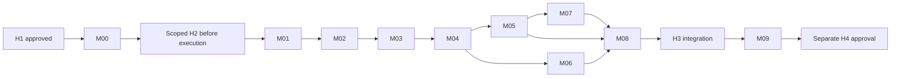

# Task dependencies

**Document status:** Dependency map v0.1, 2026-10-24; planning only, execution unapproved.

## Purpose

Define milestone ordering, shared contracts and missing inputs. Detailed task dependencies will live in each scoped execution plan; this map grants no delegation or execution permission.

## Dependency register

| Milestone | Prerequisite milestones | Required handoff |
|---|---|---|
| M00 | H1 held | Accepted architecture and operator inventory |
| M01 | M00 | First exact task plan, scoped H2, compatibility/tooling baseline |
| M02 | M01 | Config, process supervision, state/events, secret/log contracts |
| M03 | M02 | Finalized encrypted artifact/manifest and retry identity |
| M04 | M03 | Qualified committed-copy retrieval, signing and reconciliation |
| M05 | M04 | Verified-copy and restore-claim lifecycle before automated deletion |
| M06 | M04 | Provider-independent copy/integrity/import/restore contract |
| M07 | M05 | Durable backup/schedule/retention events and operator health |
| M08 | M05, M06, M07 | Complete scope plus per-feature review/verification evidence |
| M09 | M08 | Integrated candidate, H3 and authorized staging scope |

No calendar critical-path claim is made without estimates. The sequential recovery spine is M00-M04; completion then waits for both the M05/M07 branch and M06 before M08/M09. The diagram's first H2 marks the initial execution boundary; later scoped plans also require their own applicable H2 coverage, not a blanket grant from that first approval.

## Missing-input register

| ID | Input / decision | Resolution owner | Blocks | Required evidence |
|---|---|---|---|---|
| D01 | Actual database versions, selected DBs, extensions/RLS/globals needs | Operator with planning owner | M00 exit for affected engine, M02/M04 | Non-secret inventory and compatible tool/target matrix |
| D02 | Host OS/CPU/networks/resources and volume budgets | Operator/DevOps owner | M00 deployment limits, M02/M08 | Inventory, resource limits and workload fixture definition |
| D03 | R2/S3 test accounts/prefixes and Drive account/scopes | Operator/provider owner | Provider plans M03/M06 and real qualification | Isolated authorized targets, permissions and recovery access; secret references only |
| D04 | Encryption/signing custody and online verification-key access | Operator/security owner | M02/M04 execution | Provisioning/rotation/recovery procedure; architecture online-key tradeoff already approved |
| D05 | Dedicated verification/restore identity and isolation | Operator/DevOps owner | M04 | Validated target inventory, scoped credentials, cleanup boundaries and version fixtures |
| D06 | Libraries, exact test commands, schema/API types, task paths and attempt budgets | Planning owner | Each relevant H2 | Actionable writing-plans document; no placeholders in executable steps |
| D07 | Git initialization/integration destination and execution mode | Human operator | Worktrees/implementation integration | Explicit scoped authorization; no Git repository currently exists |
| D08 | Alert thresholds, history budget, observer ownership and performance limits | Operator/planning owner | M05 limits, M08/M09 acceptance | Chosen measurable values, then target-specific evidence |
| D09 | Staging target and exact production artifact/rollback scope | Release owner/human operator | M09 operations and later deployment | Separate staging authorization, readiness dossier and H4 for production |

TODO: assign named owners and resolve inventory entries before dependent plans. Missing facts do not invalidate H1 or authorize re-asking already accepted P01-P09 choices. If a fact contradicts the design, record the impact and seek only the affected change approval.

## Execution constraints

M05 and M06 may be planned independently after M04. Runtime parallelism/delegation still needs approved mode and nonconflicting file ownership. Shared schema, configuration, event envelope, copy/commit format, state enums and error contracts have one owner per change; consumer plans must agree on signatures before execution. A changed shared contract invalidates affected downstream plan/test assumptions.

Suggested future source responsibility boundaries (paths are proposals for detailed plans, not files to create now): `cmd/bkplight/` for CLI/entry, `internal/config/`, `internal/state/`, `internal/orchestrator/`, `internal/process/`, `internal/archive/`, `internal/database/`, `internal/storage/`, `internal/recovery/`, `internal/scheduler/`, `internal/retention/`, `internal/notifications/` and `internal/observability/`. Contract and integration fixtures belong in `tests/`; image/Compose assets in `deploy/`. Exact filenames and method/types must be settled in the owning scoped plan before H2. Avoid locking in a single oversized implementation plan for these separate subsystems.

## Failure propagation

Keep downstream milestones in backlog or blocked until prerequisite exit evidence exists. A failure after completion reopens affected checks: changed dump formats affect M03-M06; changed commit/copy identity affects recovery/retention/providers; a changed state schema affects restart/import/migration/rollback. Pause deletion when state/ownership is uncertain, preserve artifacts and investigate. Replan locally within valid approvals, or renew H1/H2 for material scope/contract changes. Never mark downstream recovery complete based only on mocked storage tests.

## Related documentation

- [Milestones](milestones.md)
- [Implementation plans](implementation-plans/README.md)
- [Blockers](../05-progress/blockers.md)
